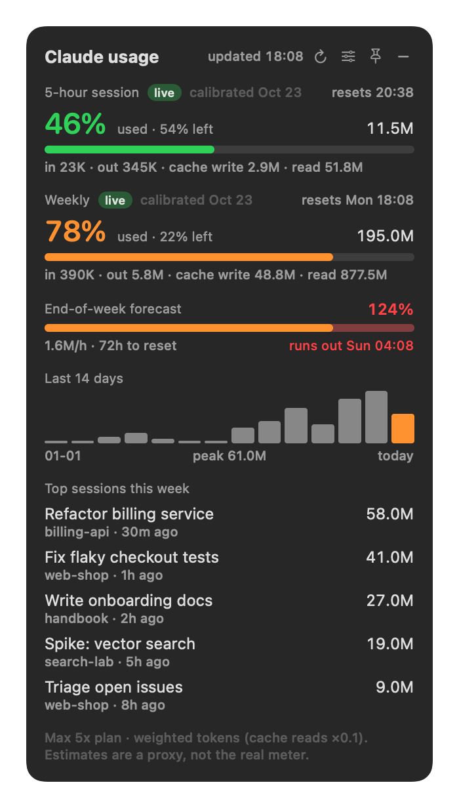

# Claude Usage Tracker

A small native macOS widget that shows how much of your Claude plan you have used: a
translucent desktop panel plus a menu-bar gauge. It reads Claude Code's local session logs.
One Swift binary, no dependencies, no network access.



*(Screenshot uses made-up demo data.)*

## What it shows

- **5-hour session** and **Weekly** meters: % used, % left, when the window resets, and the
  tokens used in it (a weighted total plus the raw input / output / cache breakdown).
  Each meter is labelled:
  - **live**: from a fresh reading of the real limit % that Claude Code passes to its
    status line (see [Live readings](#live-readings)).
  - **estimated**: your weighted usage ÷ a budget for your plan. The budget is either the
    plan default or one calibrated from your own account.
- **End-of-week forecast**: the weekly % expected at the reset and, if it would pass 100%,
  when you run out. Colours go amber at 75% and red at 90%.
- **Last 14 days** (one bar per day) and **top sessions this week** (by weighted usage).
- **Refresh**: automatic every 60 seconds, plus a ↻ button on the panel and a Refresh item
  in the menu bar. The panel shows the time it last updated.

The menu-bar item shows `5-hour % · weekly %`. **Click** it to show or hide the panel, so the
tracker can sit collapsed in the menu bar. **Right-click** (or Control-click) it for Refresh,
Calibrate, Always on Top, Show in Dock and Quit. On the panel, the pin button floats it above
other windows and the minus button collapses it into the menu bar. By default the app has no
Dock icon; turn on **Show in Dock** if you want one (clicking it brings the panel back).
Drag the panel anywhere. Its position, Always on Top, shown/collapsed and Show in Dock are all
remembered across restarts.

## Install

You need macOS 14 (Sonoma) or later and the Xcode Command Line Tools
(`xcode-select --install`). Full Xcode is not needed.

```sh
git clone https://github.com/shaunchew/claude-usage-tracker.git
cd claude-usage-tracker
./install.sh                          # build and install to ~/Applications, then start it
./install.sh --login-item             # ...and start it at every login
./install.sh --login-item --statusline  # ...and turn on live readings
```

The build is a universal binary (Apple silicon and Intel). Re-running `install.sh` upgrades in
place. To remove everything:

```sh
./uninstall.sh          # app, login item and status-line tap
./uninstall.sh --purge  # also config, calibration and the saved panel position
```

**Gatekeeper.** The app is built on your own Mac and signed ad hoc, so macOS does not
quarantine it and it opens without a warning. If you copy a built `ClaudeUsage.app` to another
Mac instead, macOS will block it the first time. Right-click → Open, or run
`xattr -dr com.apple.quarantine ~/Applications/ClaudeUsage.app`.

## Privacy

- It reads only local files: Claude Code's logs (`$CLAUDE_CONFIG_DIR/projects`, or
  `~/.claude/projects`) and its own files in `~/.config/claude-usage-tracker/`.
- It makes **no network calls** and does not touch the keychain or any credentials.
- From the status line it keeps only `rate_limits` (percentages and reset times) and a
  capture time. Your prompts, costs and everything else are discarded.

## Live readings

Claude Code sends JSON to your status-line command each time it redraws. The JSON includes
`rate_limits.five_hour` and `rate_limits.seven_day`, each with `used_percentage` and
`resets_at`. `./install.sh --statusline` adds a short, clearly marked block to your status-line
script that passes a copy of that JSON to `ClaudeUsage --tap`. Your script still gets the same
input and prints the same output.

- It backs up your script first (`<script>.bak-claude-usage-<timestamp>`).
- It does nothing if the tap is already there.
- If you have no status line, it creates a minimal one (model and folder) and registers it in
  `settings.json`.
- If your `statusLine` command is not a script file, it leaves it alone and tells you what
  to pipe to `ClaudeUsage --tap`.

A reading counts as live for 15 minutes (`liveMaxAgeMinutes`). Usage logged after the
reading is added on top, using the calibrated budget. After 15 minutes the meters fall back
to estimates. The weekly window still follows the real reset time from the last reading.

Rate-limit fields only appear for Claude.ai subscribers (Pro / Max). With an API key there is
no plan limit, so the meters stay estimated.

## Calibration

Anthropic does not publish limits in tokens, so the plan defaults are only a starting point.
To match your account:

1. Run `/usage` in Claude Code.
2. Choose **Calibrate** (the slider icon on the panel, or the menu bar), and type the
   5-hour and weekly % it shows.

The app back-solves the budget (`tokens in window ÷ %`) and averages the last 5 samples.
The meter then says `calibrated <date>`. With live readings turned on, this happens on its
own: each new reading adds a sample (readings under 5% for the 5-hour meter, or under 2%
for the weekly one, are skipped as too noisy). From a terminal:
`~/Applications/ClaudeUsage.app/Contents/MacOS/ClaudeUsage --calibrate 5h=40 week=22`.

## How usage is weighted

Raw token counts are dominated by cache reads, which count for far less than fresh tokens.
The meters therefore use **weighted tokens**, in "fresh input token" units that follow
relative API prices:

| Token type | Weight |
|---|---|
| input | 1 |
| output | 5 |
| cache write (5-minute) | 1.25 |
| cache write (1-hour) | 2 |
| cache read | 0.1 |

That figure is then multiplied by a per-model factor: opus 1, sonnet 0.6, haiku 0.2
(matched by a substring of the model id). This is a consistent proxy, not Anthropic's
actual meter, which is why calibration exists.

## Windows and forecast

- **5-hour**: when live, the real reset time. When estimated, a window opens at the first
  message after the last one closed (rounded down to the hour) and lasts 5 hours.
- **Weekly**: the real reset from the most recent status-line reading, rolled forward a week
  at a time. Before any reading exists it is Monday 00:00 in your system time zone
  (`weekStartWeekday` / `weekStartHour`).
- **Forecast**: `rate = 0.7 × week-to-date average + 0.3 × last-24-hours average` (only the
  recent rate in the first 6 hours). Weighting the week-to-date average more heavily keeps a
  single busy hour from swinging the forecast.

## Config

Optional. Create `~/.config/claude-usage-tracker/config.json` (or point
`CLAUDE_USAGE_CONFIG` at another path) with any subset of these keys, then restart the app:

```json
{
  "plan": "max5x",
  "planBudgets": {
    "pro":    { "fiveHour": 5000000,   "weekly": 50000000 },
    "max5x":  { "fiveHour": 25000000,  "weekly": 250000000 },
    "max20x": { "fiveHour": 100000000, "weekly": 1000000000 }
  },
  "modelMultipliers": { "opus": 1, "sonnet": 0.6, "haiku": 0.2 },
  "weights": { "input": 1, "output": 5, "cacheWrite5m": 1.25, "cacheWrite1h": 2, "cacheRead": 0.1 },
  "refreshSeconds": 60,
  "liveMaxAgeMinutes": 15,
  "calibrationSamples": 5,
  "weekStartWeekday": 2,
  "weekStartHour": 0,
  "timeZone": null,
  "projectsDir": null,
  "alwaysOnTop": false,
  "topSessions": 5
}
```

- `plan` is one of `pro`, `max5x` or `max20x`. Budgets are in weighted tokens.
- `timeZone` set to `null` uses the system zone.
- `projectsDir` set to `null` uses `$CLAUDE_CONFIG_DIR/projects`, else `~/.claude/projects`.
- `weekStartWeekday` uses 1 = Sunday, 2 = Monday.

## Command line

```sh
B=~/Applications/ClaudeUsage.app/Contents/MacOS/ClaudeUsage
$B --dump                       # print everything as JSON, no UI
$B --calibrate 5h=40 week=22    # calibrate from /usage figures
$B --snapshot out.png [--demo]  # render the panel to a PNG
```

## Develop

```sh
make            # build build/ClaudeUsage.app (universal)
make run        # open it
make test       # tests on fixture logs in a temp folder
make screenshot # re-render docs/screenshot.png from demo data
```

```
Sources/UsageCore.swift   config, log parsing, meters, calibration, forecast, status-line tap
Sources/App.swift         SwiftUI panel, menu-bar item, offscreen render
Sources/main.swift        entry point (--tap, --dump, --calibrate, --snapshot, or the app)
Tests/main.swift          fixture-based tests
scripts/statusline.py     adds/removes the tap in your status-line script
install.sh, uninstall.sh
```

Logs are read incrementally: a byte offset is kept per file, so each refresh reads only new
lines. Each message is counted once by `(message.id, requestId)`, because Claude Code logs the
same message on several lines. Subagent transcripts count toward the session that started them.

## Limitations

- Only Claude Code on this Mac leaves logs here. claude.ai chats and other machines use the
  same plan limits, so estimates read low if you use those too. Live readings include
  everything.
- The weighting and plan defaults are approximations. Calibrate for useful estimates.
- Config changes need a restart.

## License

MIT. See [LICENSE](LICENSE).
